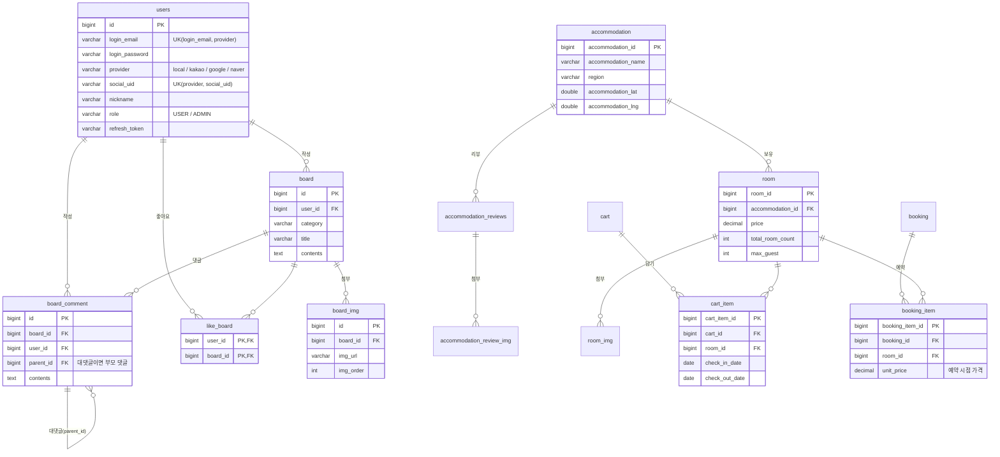

# ✈️ TripFinder

여행지 숙소를 추천·예약하고, 여행 이야기를 나누는 **여행 추천 커뮤니티** 백엔드입니다.  
2026.08 ~ 2026.09 · 3인 팀 · 프론트엔드: [React-TripFinder](https://github.com/Minjae1357/React-TripFinder)

`Java 17` `Spring Boot 4` `Spring Security` `JWT` `OAuth2` `Spring Data JPA` `MySQL` `Redis`

<br>

## 내 담당: 로그인·보안·게시판

| 영역 | 구현 내용 |
|---|---|
| 회원가입 | 이메일 인증 가입: 6자리 인증번호를 **Redis에 5분**간 저장해 확인, 비밀번호 암호화 |
| 로그인 | Spring Security + **JWT**. Access Token은 응답으로, Refresh Token은 **HttpOnly 쿠키**로 발급 |
| 소셜 로그인 | **카카오·구글·네이버** OAuth2 로그인, 성공 시 같은 방식으로 토큰 발급 |
| 게시판 | 글 작성·수정·삭제, 이미지 업로드, **대댓글**(부모 댓글 id), 좋아요(사용자+게시글 복합키) |
| 권한 | 작성자 본인과 관리자만 수정·삭제, 공지사항 카테고리는 관리자만 작성 |
| ERD | ERD 기본 설계, 팀원 요청에 따라 스키마 수정·추가 |

그 외 숙소·객실·리뷰·장바구니·예약은 팀원이 맡았습니다.

<br>

## 설계 포인트

**소셜·이메일 가입자를 한 테이블에서 관리**  
별도 소셜 계정 테이블 없이 `users`에 `provider`(local·kakao·google·naver)와 `social_uid`를 두었습니다.
- 이메일 가입자: `(login_email, provider)` UNIQUE → 같은 이메일로 중복 가입 방지
- 소셜 가입자: `(provider, social_uid)` UNIQUE → 카카오처럼 이메일을 주지 않는 경우에도 식별
- 비밀번호는 이메일 가입자만 필수, 관리자 권한은 별도 테이블 없이 `role` 컬럼으로 통합

**Refresh Token은 쿠키로**  
Refresh Token을 JavaScript에서 읽을 수 없도록 HttpOnly 쿠키로 내려주고, 로그아웃 시 쿠키를 지워 만료시킵니다.

<br>

## ERD

엔티티 코드 기준으로 그린 ERD입니다.



<br>

## API (내 담당)

| Method | URL | 설명 |
|---|---|---|
| POST | `/api/v1/auth/email-send` · `email-verify` · `email-check` | 인증번호 발송·확인, 이메일 중복 확인 |
| POST | `/api/v1/auth/signup` · `login` · `logout` | 회원가입, 로그인, 로그아웃 |
| GET | `/api/v1/auth/me` | 내 정보 |
| GET·POST | `/api/v1/board` | 게시글 목록·작성 |
| GET·PUT·DELETE | `/api/v1/board/{boardId}` | 게시글 상세·수정·삭제 |
| POST | `/api/v1/board/upload` | 이미지 업로드 |
| GET·POST | `/api/v1/board/{boardId}/comments` | 댓글·대댓글 |
| PUT·DELETE | `/api/v1/board/comments/{commentId}` | 댓글 수정·삭제 |
| GET·POST | `/api/v1/board/{boardId}/like` | 좋아요 상태·토글 |

<br>

## 실행 방법

MySQL과 Redis가 필요합니다. 메일 발송 계정, OAuth2 클라이언트 키, JWT 비밀키는 환경 변수로 설정합니다.

```bash
./mvnw spring-boot:run
```
